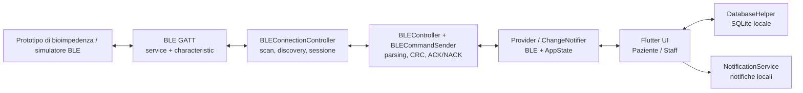
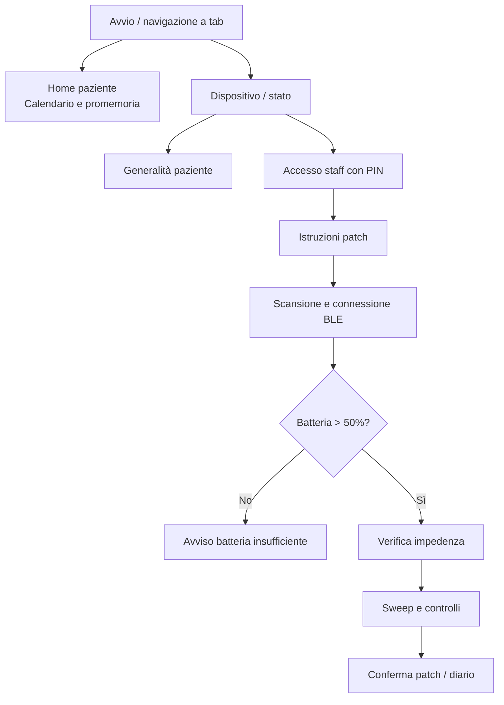

# InsulinGuard

**Applicazione Flutter per la gestione delle somministrazioni di insulina e l'interazione BLE con un prototipo di monitoraggio della bioimpedenza cutanea.**

[](https://flutter.dev/)
[](https://dart.dev/)


> [!IMPORTANT]
> **Prototipo accademico, non dispositivo medico certificato.** Le procedure di controllo della patch e le soglie nel codice non costituiscono una validazione clinica. Non usare il software per prendere decisioni terapeutiche o determinare dosi di insulina. La documentazione descrive il repository analizzato, non certifica il funzionamento end-to-end con hardware reale.

## Indice

- [Panoramica](#panoramica)
- [Schermate dell’applicazione](#schermate-dellapplicazione)
- [Funzionalità e stato di implementazione](#funzionalità-e-stato-di-implementazione)
- [Architettura](#architettura)
- [Modulo BLE](#modulo-ble)
- [Frontend e UX](#frontend-e-ux)
- [Stack tecnologico](#stack-tecnologico)
- [Prerequisiti e avvio locale](#prerequisiti-e-avvio-locale)
- [Documentazione tecnica](#documentazione-tecnica)
- [Riferimenti accademici](#riferimenti-accademici)
- [Contributi](#contributi)

## Panoramica

InsulinGuard nasce in un contesto di ricerca universitaria sul monitoraggio **non invasivo e indiretto** dei fenomeni associati alla somministrazione sottocutanea di insulina. L'app interagisce via **Bluetooth Low Energy (BLE)** con un prototipo capace di produrre misure della componente reale e immaginaria dell'impedenza; fornisce inoltre un diario locale delle somministrazioni e una procedura guidata per l'applicazione della patch.

L'interfaccia distingue due percorsi d'uso:

- **Paziente:** visualizzazione e gestione delle somministrazioni, conferma dell'esecuzione, promemoria locali e informazioni sul dispositivo.
- **Personale sanitario:** accesso tramite PIN dimostrativo, ricerca/connessione del dispositivo, lettura della batteria, test di applicazione della patch e acquisizione sweep.

Le due tesi associate descrivono un **ciclo di monitoraggio previsto di 48 ore**, con campionamento più frequente nell'intervallo da 20 minuti prima a 40 minuti dopo una somministrazione. **La completa schedulazione autonoma di tali fasi sul dispositivo non è dimostrata dai sorgenti Flutter esaminati** e va considerata un requisito di sistema, non una funzionalità verificata.

## Schermate dell'applicazione

Panoramica delle principali interfacce dell'app, riprese dagli screenshot presenti nelle due tesi. **Seleziona un'immagine per aprirla a dimensione originale.** Le schermate mostrano un prototipo e includono dati dimostrativi: non rappresentano una validazione del dispositivo o dell'applicazione per impiego clinico.

<table>
  <tr>
    <td align="center" width="33%">
      <a href="assets/screenshots/home.png"></a><br />
      <sub><b>Home e diario</b></sub>
    </td>
    <td align="center" width="33%">
      <a href="assets/screenshots/device.png"></a><br />
      <sub><b>Dispositivo</b></sub>
    </td>
    <td align="center" width="33%">
      <a href="assets/screenshots/medical-staff.png"></a><br />
      <sub><b>Area personale sanitario</b></sub>
    </td>
  </tr>
  <tr>
    <td align="center">
      <a href="assets/screenshots/ble-scan.png"></a><br />
      <sub><b>Ricerca periferiche BLE</b></sub>
    </td>
    <td align="center">
      <a href="assets/screenshots/battery-check.png"></a><br />
      <sub><b>Controllo batteria</b></sub>
    </td>
    <td align="center">
      <a href="assets/screenshots/patch-confirmation.png"></a><br />
      <sub><b>Conferma applicazione patch</b></sub>
    </td>
  </tr>
</table>

*Provenienza: i primi cinque screenshot sono tratti dalle Figure 3.1 e 3.2 della tesi sul Front-End (Michele Contino, a.a. 2025/2026); la conferma della patch proviene dalla Figura 3.6 della tesi BLE (Lorenzo Bartoli, a.a. 2024/2025). Le immagini sono incluse localmente nella cartella [`assets/screenshots/`](assets/screenshots/): non dipendono da Google Drive o da hosting esterni.*

## Funzionalità e stato di implementazione

| Area | Cosa è presente nel codice | Limiti documentati |
| --- | --- | --- |
| Diario | CRUD locale delle somministrazioni con SQLite; marcatura `isTaken` | Alcune incongruenze tra modello dati, presentazione e formati orari |
| Promemoria | Pianificazione locale via `flutter_local_notifications` | Inizializzazione esplicitamente Android; comportamento iOS da completare/verificare |
| Connessione BLE | Scansione, filtro, discovery GATT, subscribe, connessione e tentativi di riconnessione | Nessun test end-to-end eseguito in questa revisione; cleanup e gestione errori da irrobustire |
| Protocollo applicativo | Comandi con CRC16, ACK/NACK, parsing pacchetti a 5 e 7 byte | Differenze tra requisiti di tesi e implementazione; vedi [protocollo](docs/BLE_PROTOCOL.md) |
| Controllo patch | Lettura batteria, verifica impedenza, sweep e controlli statistici nel client | Soglie prototipali, nessuna convalida clinica; alcune condizioni non coincidono con le specifiche accademiche |
| Accesso staff | PIN modificabile e salvato tramite `shared_preferences` | PIN di default e storage non idonei come autenticazione di produzione |
| Multi-piattaforma | Struttura Flutter con cartelle Android/iOS/desktop/web | Supporto operativo BLE/permessi non attestato per tutte le piattaforme |

## Architettura



Questo schema rappresenta il **flusso logico**. A livello di implementazione, i controller BLE usano `ChangeNotifier`; `main.dart` li inietta con `MultiProvider` e `ChangeNotifierProxyProvider`. Il diario accede anche **direttamente** a `DatabaseHelper`, anziché transitare integralmente da `AppState`. Non è quindi un'architettura a layer rigorosamente isolati né un'implementazione BLoC/Riverpod.

Le responsabilità sono descritte in dettaglio in [Architettura](docs/ARCHITECTURE.md).

### Organizzazione del progetto

```text
appInsulin/
├── lib/
│   ├── main.dart
│   ├── core/
│   │   ├── app_state.dart
│   │   ├── ble_connection.dart
│   │   ├── ble_handler.dart
│   │   ├── ble_commandSender.dart
│   │   ├── database_helper.dart
│   │   ├── notification_service.dart
│   │   ├── permission_handler_service.dart
│   │   └── data_manager.dart
│   ├── ui/
│   │   ├── pages/        # Schermate paziente, staff e percorso patch
│   │   └── widgets/      # Navigazione e banner di stato BLE
│   └── utils/
│       └── complex_numbers.dart
├── android/
├── ios/
├── test/
│   └── widget_test.dart
├── pubspec.yaml
└── pubspec.lock
```

## Modulo BLE

Il client usa `flutter_reactive_ble` per la connessione GATT e un **servizio e una caratteristica applicativa custom**, condivisi dalle operazioni di lettura/scrittura/notifica:

| Risorsa | UUID nel sorgente |
| --- | --- |
| Service | `26ddc6b7-8d50-41d5-a1e2-8b2e1d0636fb` |
| Characteristic | `11235a37-444a-4389-bc22-edf0b0a3997f` |

Il flusso documentato nel codice è:

1. Richiesta dei permessi e scansione; filtro client-side per nome contenente `insulin` o `esp`, oppure per service UUID.
2. Selezione della periferica, `connectToDevice` e monitoraggio dello stato.
3. Richiesta MTU di 100, discovery del servizio/characteristic e `subscribeToCharacteristic`.
4. Ricezione dei byte nel `BLEController`, verifica CRC16 e interpretazione di ACK, NACK o campioni.
5. Emissione di eventi tramite `notifyListeners()` per aggiornare le parti di UI che osservano i controller.
6. In caso di disconnessione involontaria, **fino a 3 tentativi** di riconnessione con **2 secondi** di ritardo; disconnessione manuale senza tentativi automatici.

### Protocollo applicativo: riepilogo

| Elemento | Valore / struttura verificata nel codice Dart |
| --- | --- |
| CRC | CRC-16 con polinomio `0x1021`, inizializzazione `0xFFFF`; byte CRC MSB prima |
| ACK | `0x55` (esiste forma semplice e forma con CRC) |
| NACK | `0xAA` (possibile lista di sequence number e CRC) |
| Batteria | Richiesta comando `0x00` |
| Generalità paziente | Comando `0x01`, campi separati da `0x00` |
| Misura a singola frequenza | Comando `0x02` |
| Sweep | Comando `0x03`; attualmente payload `[numero_spettri, numero_frequenze]` |
| STOP | Comando `0xFF` |
| Campione a singola frequenza | 5 byte: `seq, real, imag, CRC_hi, CRC_lo` |
| Campione sweep | 7 byte: `seq, real_lo, real_hi, imag_lo, imag_hi, CRC_hi, CRC_lo` |

Il client interpreta i valori sweep reale/immaginario come **interi signed a 16 bit little-endian**. Non confondere la lunghezza di un *campione applicativo* con la dimensione di una notifica GATT, che può contenere più campioni.

**Importante:** il codice e le tesi non specificano in modo pienamente concorde la temporizzazione di ACK cumulativi, gruppi da 10 campioni e parametri frequenziali. L'implementazione va testata con una versione identificata del firmware. Per tracciato byte-by-byte, CRC, sequenze e discrepanze si veda [Protocollo BLE](docs/BLE_PROTOCOL.md).

## Frontend e UX

Il progetto combina `MaterialApp` e componenti **Material** con una navigazione **Cupertino** (`CupertinoTabScaffold`, `CupertinoTabView`). La UI segue il percorso operativo descritto nella tesi Front-End, senza imporre un design system esterno formalizzato.



Il diagramma è una **sintesi del flusso principale previsto**: i singoli errori e le transizioni automatiche sono descritti in [Frontend & UX](docs/FRONTEND_UX.md), senza assumere che tutti i rami siano funzionanti su dispositivo reale.

### Componenti principali

| Percorso | Responsabilità |
| --- | --- |
| `ui/widgets/bottom_navigation_bar.dart` | Navigazione a tab Home / Dispositivo |
| `ui/pages/home_page.dart` | Elenco somministrazioni, prossima dose, azioni sul diario |
| `ui/pages/secondary_page.dart` | Stato BLE e accesso a generalità / staff |
| `ui/pages/blue_connection.dart` | Scansione, selezione periferica, verifica livello batteria |
| `ui/pages/battery_confermation_page.dart` | Avvio dei controlli di impedenza e sweep |
| `ui/pages/medical_staff_page.dart` | Procedura patch e modifica PIN |
| `core/app_state.dart` | Stato app e preferenze locali |

## Stack tecnologico

Le **versioni richieste** vengono da `pubspec.yaml`; le versioni **risolte** da `pubspec.lock` della cartella Drive esaminata.

| Tecnologia | Dichiarata | Risolta | Utilizzo |
| --- | --- | --- | --- |
| Dart SDK | `^3.6.2` | vincolo lock `>=3.7.0-0 <4.0.0` | Linguaggio/runtime |
| `flutter_reactive_ble` | non vincolata | `5.4.0` | GATT BLE |
| `provider` | `^6.1.0` | `6.1.2` | Dipendenze e `ChangeNotifier` |
| `sqflite` | `^2.3.0` | `2.4.1` | Diario SQLite |
| `sqflite_common_ffi` | `^2.3.0` | `2.3.4+4` | Database su Windows/Linux |
| `shared_preferences` | `^2.2.2` | `2.5.1` | Preferenze e PIN demo |
| `flutter_local_notifications` | `^17.2.1` | `17.2.4` | Notifiche locali |
| `timezone` | `^0.9.4` | `0.9.4` | Calcolo orari notifiche |
| `permission_handler` | non vincolata | `11.3.1` | Richiesta permessi |
| `intl` | `^0.18.0` | `0.18.1` | Date e formattazione |

Sono presenti anche `path`, `path_provider`, `cupertino_icons` e `flutter_lints`. Il progetto dichiara `publish_to: none`. Vedi [Development & Setup](docs/DEVELOPMENT.md) per i prerequisiti e la verifica locale.

## Prerequisiti e avvio locale

- Flutter SDK con **Dart compatibile con `^3.6.2`** e con il lock file corrente (il lock richiede `>=3.7.0-0`). Versione Flutter esatta: **TODO: confermare la toolchain usata per l'ultima build riuscita**.
- Android Studio/Android SDK per Android, oppure macOS + Xcode/CocoaPods per sperimentare una build iOS.
- Dispositivo fisico con BLE per test radio realistici; un emulatore da solo non prova il protocollo con una periferica.
- **JDK 17** per il modulo Gradle Android presente nella copia esaminata.

```bash
# Posizionarsi nella root del progetto Flutter
flutter doctor -v
flutter pub get
flutter analyze
flutter test
flutter run
```

> [!WARNING]
> **Non è stato eseguito alcun build/test in questa revisione** (SDK Flutter non disponibile nell'ambiente di analisi). `test/widget_test.dart` è ancora un test counter generico e non verifica InsulinGuard. Non interpretare questi comandi come prova che l'app compili o i test passino.

Per i permessi Android effettivamente dichiarati, le lacune in `Info.plist`, il setup del simulatore e i prerequisiti alla release, consultare [Development & Setup](docs/DEVELOPMENT.md).

## Documentazione tecnica

| Documento | Contenuto |
| --- | --- |
| [Architettura](docs/ARCHITECTURE.md) | Componenti, dati, dipendenze, lifecycle e diagrammi Mermaid |
| [Protocollo BLE](docs/BLE_PROTOCOL.md) | Tabella comandi, layout dei pacchetti, CRC, sequenze ACK/NACK, divergenze |
| [Frontend & UX](docs/FRONTEND_UX.md) | Schermate, navigazione, reattività, design e accessibilità |
| [Development & Setup](docs/DEVELOPMENT.md) | Toolchain, configurazione OS, run/test, checklist di rilascio |
| [Verifiche e problemi noti](docs/KNOWN_ISSUES.md) | Gap tra tesi e sorgente, rischi di correttezza, sicurezza e portabilità |
| [Riferimenti accademici](docs/ACADEMIC_REFERENCES.md) | Citazioni bibliografiche e mappa dei contributi |
| [Contribuire](CONTRIBUTING.md) | Convenzioni suggerite per issue e pull request |

## Riferimenti accademici

Questa implementazione è descritta da due elaborati dell'**Università degli Studi di Napoli Federico II**, entrambi in Ingegneria Informatica:

1. **Lorenzo Bartoli** (a.a. 2024/2025), *Connessioni vitali: progettazione e simulazione di un sistema BLE embedded per la comunicazione in applicazioni biomedicali*. Relatore: Nicola Moccaldi; correlatori: Francesco Caputo, Rosanna Manzo.
2. **Michele Contino** (a.a. 2025/2026), *Progettazione e realizzazione del front-end di un’app mobile per il monitoraggio della terapia insulinica*. Relatore: Nicola Moccaldi; correlatori: Francesco Caputo, Rosanna Manzo.

Dettagli: [Riferimenti accademici](docs/ACADEMIC_REFERENCES.md).

## Contributi

Per proporre modifiche, aprire una issue o seguire [CONTRIBUTING.md](CONTRIBUTING.md). **TODO: [Confermare repository GitHub, maintainer e policy di accettazione delle contribuzioni].**
