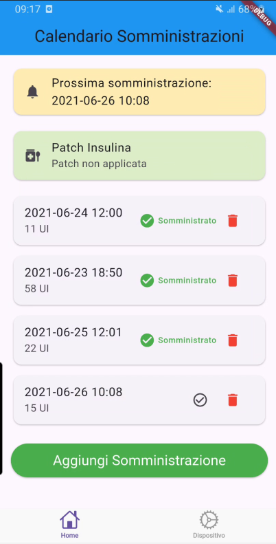
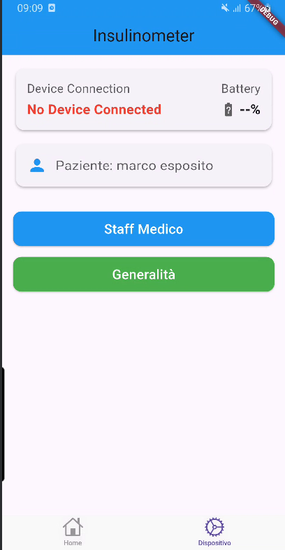
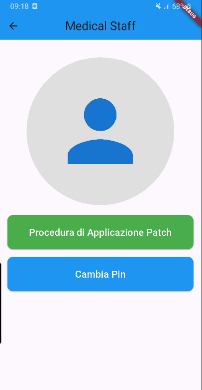
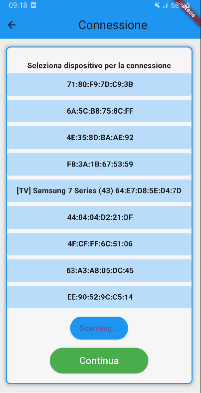
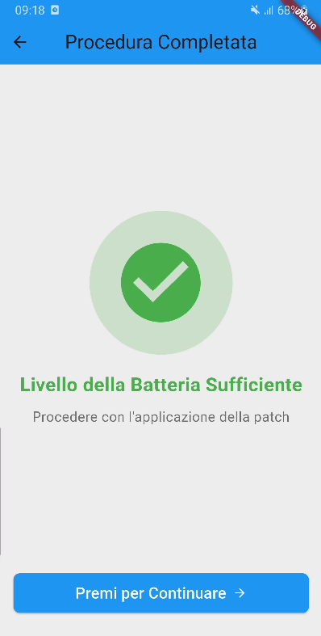
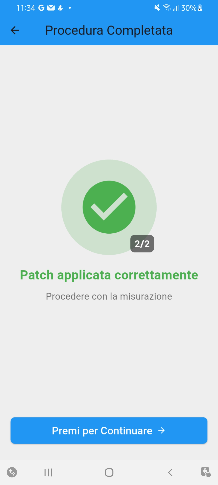
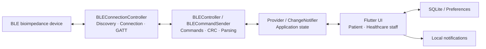
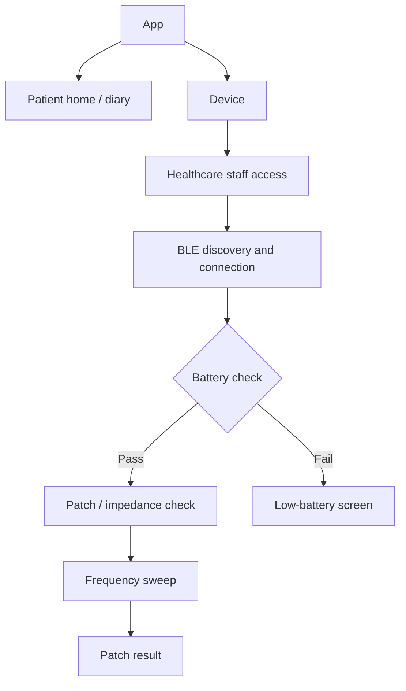

# InsulinGuard

**Flutter application for insulin administration tracking and Bluetooth Low Energy (BLE) communication with a skin-bioimpedance monitoring prototype.**

[](https://flutter.dev/)
[](https://dart.dev/)

> **Research prototype:** InsulinGuard is not a certified medical device and must not be used to make treatment or insulin-dosing decisions.

## Overview

InsulinGuard was developed at the **University of Naples Federico II** as part of a research project exploring bioimpedance-based monitoring of subcutaneous insulin administration. The application provides a mobile interface for a BLE-enabled measurement prototype, together with a local administration diary and a guided device setup procedure.

The application supports two main workflows:

- **Patient:** manage the administration diary, confirm recorded doses, review upcoming administrations, and receive local reminders.
- **Healthcare staff:** connect to the BLE device, check battery status, guide patch placement, and run impedance measurements and sweeps.

The proposed monitoring model uses a **48-hour observation period** with faster sampling from **20 minutes before to 40 minutes after** each administration, and slower sampling between these windows.

## Screenshots

<table>
  <tr>
    <td align="center" width="33%">
      <a href="assets/screenshots/home.png"></a><br />
      <sub><b>Home</b></sub>
    </td>
    <td align="center" width="33%">
      <a href="assets/screenshots/device.png"></a><br />
      <sub><b>Device</b></sub>
    </td>
    <td align="center" width="33%">
      <a href="assets/screenshots/medical-staff.png"></a><br />
      <sub><b>Healthcare staff</b></sub>
    </td>
  </tr>
  <tr>
    <td align="center">
      <a href="assets/screenshots/ble-scan.png"></a><br />
      <sub><b>BLE discovery</b></sub>
    </td>
    <td align="center">
      <a href="assets/screenshots/battery-check.png"></a><br />
      <sub><b>Battery check</b></sub>
    </td>
    <td align="center">
      <a href="assets/screenshots/patch-confirmation.png"></a><br />
      <sub><b>Patch confirmation</b></sub>
    </td>
  </tr>
</table>

## Key features

| Area | Functionality |
| --- | --- |
| Administration diary | Local SQLite storage of administrations, dates, insulin types, and completion status |
| Reminders | Scheduled local notifications for upcoming administrations |
| BLE communication | Peripheral discovery, GATT connection, notifications, and reconnection attempts |
| Measurements | Single-frequency impedance acquisition and frequency sweeps |
| Data integrity | CRC16 checks, ACK/NACK handling, and packet decoding |
| Patch setup | Guided battery, electrode-contact, and measurement checks |
| State management | Reactive updates through `Provider` and `ChangeNotifier` |

Some platform-specific features and hardware interactions remain under development; see [Known issues](docs/KNOWN_ISSUES.md).

## Architecture

The project separates the **Flutter UI**, **application state and local data**, and **BLE communication** into focused modules.



The application uses **Provider with `ChangeNotifier`** for reactive UI updates and `sqflite` for local persistence. BLE connections are managed with `flutter_reactive_ble`.

### Project layout

```text
appInsulin/
├── lib/
│   ├── main.dart
│   ├── core/                 # BLE, state, persistence, notifications
│   ├── ui/
│   │   ├── pages/           # Patient and healthcare-staff screens
│   │   └── widgets/         # Shared interface components
│   └── utils/
├── android/
├── ios/
├── test/
├── assets/screenshots/
├── docs/
├── pubspec.yaml
├── pubspec.lock
├── README.md
└── CONTRIBUTING.md
```

For the component diagram, data lifecycle, and connection sequence, see [System architecture](docs/ARCHITECTURE.md).

## BLE communication

InsulinGuard uses a custom GATT service and characteristic for communication with the measurement device.

| GATT resource | UUID |
| --- | --- |
| Service | `26ddc6b7-8d50-41d5-a1e2-8b2e1d0636fb` |
| Characteristic | `11235a37-444a-4389-bc22-edf0b0a3997f` |

The communication flow consists of device discovery, connection, GATT service discovery, notification subscription, command transmission, and response processing. The protocol supports battery queries, single-frequency measurements, sweeps, and measurement termination.

| Command | ID |
| --- | --- |
| Battery request | `0x00` |
| Patient information | `0x01` |
| Single-frequency measurement | `0x02` |
| Frequency sweep | `0x03` |
| Stop measurement | `0xFF` |

Packets use **CRC16** (`0x1021`, initialization `0xFFFF`) to detect transmission errors, with **ACK (`0x55`)** and **NACK (`0xAA`)** responses. The data decoder handles 5-byte single-frequency samples and 7-byte sweep samples.

See [BLE protocol](docs/BLE_PROTOCOL.md) for byte layouts, parsing, retransmission behavior, and interoperability details.

## Interface and navigation

The UI combines **Material** components with **Cupertino** navigation. The healthcare-staff workflow guides the user through device selection, battery verification, patch placement, and measurement checks.



See [Frontend and UX](docs/FRONTEND_UX.md) for individual screens, navigation, user interactions, and state updates.

## Tech stack

| Package | Version in `pubspec.lock` | Purpose |
| --- | --- | --- |
| `flutter_reactive_ble` | `5.4.0` | BLE communication |
| `provider` | `6.1.2` | State management |
| `sqflite` | `2.4.1` | Local administration diary |
| `sqflite_common_ffi` | `2.3.4+4` | Desktop SQLite support |
| `shared_preferences` | `2.5.1` | Local settings |
| `flutter_local_notifications` | `17.2.4` | Reminders |
| `permission_handler` | `11.3.1` | Platform permissions |
| `intl` | `0.18.1` | Date and time formatting |

The project declares Dart SDK compatibility with `^3.6.2`. Additional dependencies are listed in [`pubspec.yaml`](pubspec.yaml).

## Getting started

Install Flutter and the platform tooling for your target device. Android development requires the Android SDK and JDK 17; iOS builds require macOS and Xcode.

From the project root:

```bash
flutter doctor
flutter pub get
flutter run
```

For static analysis and tests:

```bash
flutter analyze
flutter test
```

A physical BLE-capable device is recommended for communication testing. iOS Bluetooth permissions and platform notification setup require further configuration before device use. See [Development and setup](docs/DEVELOPMENT.md).

## Documentation

| Guide | Description |
| --- | --- |
| [Architecture](docs/ARCHITECTURE.md) | Module responsibilities, state, and data flow |
| [BLE protocol](docs/BLE_PROTOCOL.md) | GATT, commands, packet formats, CRC16, ACK/NACK |
| [Frontend and UX](docs/FRONTEND_UX.md) | Screens, navigation, interaction and state updates |
| [Development and setup](docs/DEVELOPMENT.md) | Local setup, OS permissions, and testing |
| [Known issues](docs/KNOWN_ISSUES.md) | Current technical limitations and improvement areas |
| [Academic references](docs/ACADEMIC_REFERENCES.md) | University theses and technical references |
| [Contributing](CONTRIBUTING.md) | Guidelines for contributions |

## Academic background

InsulinGuard was developed in connection with two Computer Engineering theses at the **University of Naples Federico II**:

- **Lorenzo Bartoli (2024/2025):** *Connessioni vitali: progettazione e simulazione di un sistema BLE embedded per la comunicazione in applicazioni biomedicali* — BLE communication and protocol development.
- **Michele Contino (2025/2026):** *Progettazione e realizzazione del front-end di un’app mobile per il monitoraggio della terapia insulinica* — Flutter frontend, navigation, and interface design.

Full bibliographic details are available in [Academic references](docs/ACADEMIC_REFERENCES.md).

## Contributing

Contributions and improvements are welcome. See [CONTRIBUTING.md](CONTRIBUTING.md) for the development workflow and pull-request guidelines.
