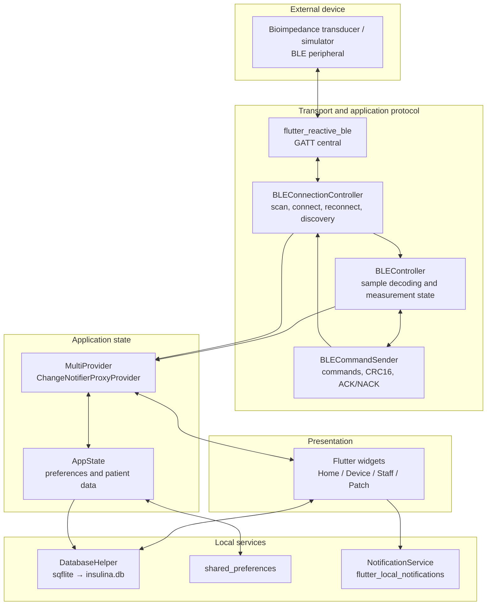

# System Architecture

[← README](../README.md) · [BLE protocol](BLE_PROTOCOL.md) · [Frontend and UX](FRONTEND_UX.md)

## System components

InsulinGuard is organized around three responsibilities: **Flutter frontend, data management, and BLE communication**. Provider connects the UI with Dart controllers and local services. The application uses local persistence; there is no cloud backend integration.

During GATT discovery, `BLEController.setBLE(...)` provides the command sender with `FlutterReactiveBle` and a `QualifiedCharacteristic`.

## Startup and responsibilities

`main.dart` calls `WidgetsFlutterBinding.ensureInitialized()`, initializes `NotificationService`, and creates a `MultiProvider` with `BLEController`, `BLEConnectionController` (injected through `ChangeNotifierProxyProvider` and `injectBLEController`), and `AppState`. The UI starts with `MaterialApp` and `CustomBottomNav`; `Provider.of`/`Consumer` respond to `notifyListeners()`.

| Component | Responsibility |
| --- | --- |
| `core/ble_connection.dart` · `BLEConnectionController` | Scanning, connection, reconnection, GATT discovery, and notification subscriptions |
| `core/ble_handler.dart` · `BLEController` | Decoding, CRC, battery/sample/sweep state, and calculations used for patch checks; also triggers navigation on some paths |
| `core/ble_commandSender.dart` · `BLECommandSender` | Constructs payloads/CRC and writes GATT commands while waiting for application-level acknowledgments |
| `core/app_state.dart` · `AppState` | Patient state, demonstration staff PIN, patch state, and next event |
| `core/database_helper.dart` · `DatabaseHelper` | SQLite persistence of administrations |
| `core/notification_service.dart`, `permission_handler_service.dart` | Local reminders and notification/alarm permissions |
| `core/data_manager.dart`, `utils/complex_numbers.dart` | Helpers, simulated data, and supporting operations |
| `ui/pages/`, `ui/widgets/` | Screens, navigation, and coordination of user workflows |

State management uses **Provider + `ChangeNotifier`**.

## BLE data exchange

`requestMtu(100)` requests a larger MTU; the negotiated value depends on the peripheral and operating system. See [BLE protocol](BLE_PROTOCOL.md) for the byte-level format.

## Local data and state

- **SQLite:** `DatabaseHelper` opens `insulina.db` (schema version 3). The `somministrazioni` table includes `id` (autoincrement primary key), `date`, `time`, `dosage`, `insulinType` (text), and `isTaken` (integer 0/1). The helper supports inserts, reads, updates, deletion, status changes, and next-event lookup. Some callers use a `meal` field that is absent from the database schema; see [Known issues](KNOWN_ISSUES.md).
- **Preferences:** `AppState` stores `staff_pin`, `is_patch_applied`, `patch_replacement_date`, `user_nome`, `user_cognome`, and `user_data_nascita`. The default PIN is `0000`; `shared_preferences` is not intended for secure authentication.
- **Notifications:** `HomePage` schedules a reminder one minute before the next upcoming dose; other routes, including the administration log, also schedule notifications. Synchronization after every edit/deletion is not centralized.

## Design considerations

Some application responsibilities cross module boundaries: `BLEController` performs navigation through `BuildContext`, screens coordinate timeouts and measurement checks, and administration data is read directly from `DatabaseHelper`. Future refactoring can isolate protocol events from navigation and consolidate data access behind a repository. The related issues are tracked in [Known issues](KNOWN_ISSUES.md).
