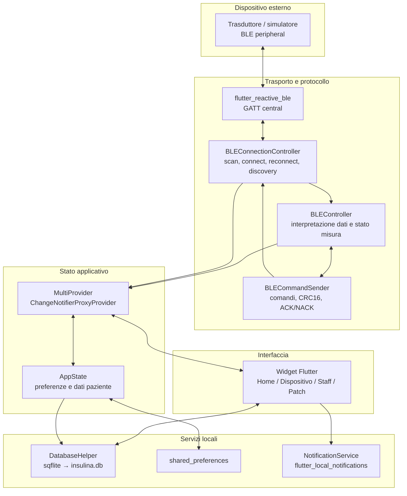
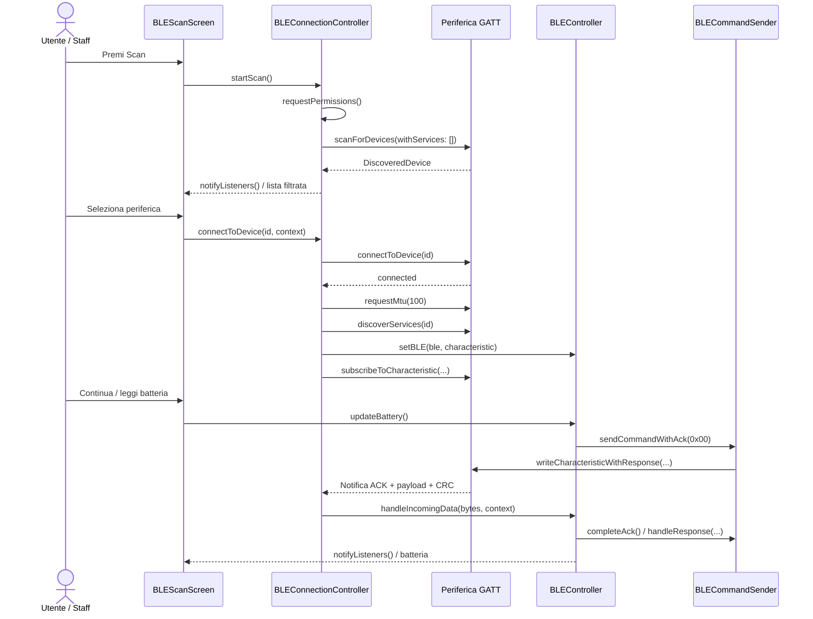

# Architettura del sistema

[← README](../README.md) · [Protocollo BLE](BLE_PROTOCOL.md) · [Frontend & UX](FRONTEND_UX.md)

## Ambito e componenti

La tesi Front-End (Michele Contino, cap. 2) distingue **Front-End, Data Handler e Connessione BLE**. La copia Drive `appInsulin` realizza tali responsabilità attraverso Provider, controller Dart e servizi locali: **non è stata identificata un'API o un backend cloud**. Le capacità dichiarate nelle tesi non equivalgono automaticamente a funzionalità verificate nel codice.

Il collegamento tra `BLECommandSender` e connessione nel diagramma è **logico**: il sender riceve direttamente `FlutterReactiveBle` e `QualifiedCharacteristic` tramite `BLEController.setBLE(...)` durante la discovery.

## Avvio e responsabilità

`main.dart` chiama `WidgetsFlutterBinding.ensureInitialized()`, inizializza `NotificationService` e crea un `MultiProvider` con `BLEController`, `BLEConnectionController` (tramite `ChangeNotifierProxyProvider` e `injectBLEController`) e `AppState`. L'UI parte da `MaterialApp` e `CustomBottomNav`; `Provider.of`/`Consumer` reagiscono a `notifyListeners()`.

| Componente | Responsabilità osservata |
| --- | --- |
| `core/ble_connection.dart` · `BLEConnectionController` | Scansione, connessione, riconnessione, GATT discovery e sottoscrizione alle notifiche. |
| `core/ble_handler.dart` · `BLEController` | Decodifica, CRC, stato batteria/campioni/sweep e calcoli per l'esito patch; in alcuni percorsi naviga direttamente. |
| `core/ble_commandSender.dart` · `BLECommandSender` | Crea payload/CRC e invia comandi GATT con attesa ACK applicativo. |
| `core/app_state.dart` · `AppState` | Stato paziente, PIN dimostrativo, patch e prossimo evento. |
| `core/database_helper.dart` · `DatabaseHelper` | Persistenza SQLite delle somministrazioni. |
| `core/notification_service.dart`, `permission_handler_service.dart` | Promemoria locali e permessi notifiche/allarmi. |
| `core/data_manager.dart`, `utils/complex_numbers.dart` | Helper e dati simulati/operazioni di supporto. |
| `ui/pages/`, `ui/widgets/` | Schermate, navigazione e orchestrazione dei flussi utente. |

Il pattern effettivo è **Provider + `ChangeNotifier`**: non BLoC, Riverpod né una Clean Architecture formalmente stratificata.

## Scambio dati BLE

La richiesta `requestMtu(100)` appare nel percorso di connessione; **MTU effettivo e compatibilità multipiattaforma non sono stati verificati**. Per il wire format, vedi [Protocollo BLE](BLE_PROTOCOL.md).

## Dati locali e stato

- **SQLite:** `DatabaseHelper` apre `insulina.db` (schema v3); `somministrazioni` contiene `id` (PK autoincrementale), `date`, `time`, `dosage`, `insulinType` (testo) e `isTaken` (intero 0/1). Offre lettura, inserimento, modifica, cancellazione, marcatura e ricerca del prossimo evento. Il parametro `meal` è usato in alcuni percorsi ma **non è una colonna dello schema**.
- **Preferenze:** `AppState` conserva `staff_pin`, `is_patch_applied`, `patch_replacement_date`, `user_nome`, `user_cognome` e `user_data_nascita`. Il PIN di fallback `0000` e `shared_preferences` **non costituiscono autenticazione o storage sicuro**.
- **Notifiche:** `HomePage` pianifica un promemoria un minuto prima della prossima dose futura; altri percorsi, incluso il diario, schedulano notifiche. La sincronizzazione di tutte le modifiche/cancellazioni non è centralizzata.

## Confini architetturali

La separazione dei moduli è **parziale**: `BLEController` usa `BuildContext`/`Navigator`, alcuni widget gestiscono timeout e controlli statistici, il ciclo di vita di tutte le subscription BLE non è completamente tracciato, e `HomePage` istanzia un `AppState` separato per la card patch. Non risulta verificato uno scheduler BLE completo per le finestre del ciclo da 48 ore.

**Evoluzione proposta, non implementata:** eventi di dominio disaccoppiati dalla UI (`BatteryRead`, `SweepCompleted`, `ProtocolError`), gestione esplicita delle subscription e repository unico per il diario. Priorità e differenze rispetto alle tesi: [Verifiche e problemi noti](KNOWN_ISSUES.md).
