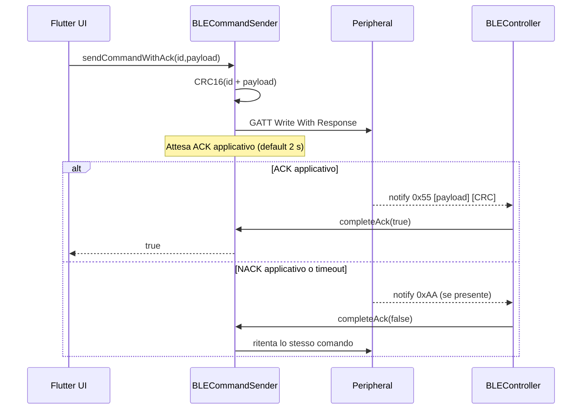

# Protocollo BLE: implementazione e interoperabilità

[← README](../README.md) · [Architettura](ARCHITECTURE.md) · [Verifiche](KNOWN_ISSUES.md)

> **Ambito:** questa pagina documenta il **protocollo applicativo effettivamente leggibile nei sorgenti Dart** (`ble_connection.dart`, `ble_handler.dart`, `ble_commandSender.dart`) e nel simulatore Python `ble_simulator.py` fornito separatamente. Il simulatore non è stato verificato come file versionato dentro `appInsulin`. Le tesi rappresentano anche requisiti o configurazioni progettuali che possono differire dal codice qui presente.

## 1. BLE/GATT

| Proprietà | Valore |
| --- | --- |
| Ruolo smartphone | BLE Central / GATT client |
| Ruolo dispositivo | BLE Peripheral / GATT server |
| Service UUID | `26ddc6b7-8d50-41d5-a1e2-8b2e1d0636fb` |
| Characteristic UUID | `11235a37-444a-4389-bc22-edf0b0a3997f` |
| Metodo scrittura client | `writeCharacteristicWithResponse` |
| Metodo ricezione client | `subscribeToCharacteristic` |
| MTU richiesto dal client | `100` (valore richiesto, non garantito su tutti i device) |
| Ricerca periferiche | Scansione senza filtri di servizio nativi, poi filtro lato Dart: nome `insulin`, nome `esp` oppure UUID compatibile |

Nel simulatore Python, la stessa characteristic viene creata con proprietà `read`, `write`, `notify`. In produzione verificare servizi, properties, permissions e descrittori effettivamente esposti dal firmware.

## 2. CRC e codifica

La funzione `BLECommandSender.calculateCrc16()` calcola un CRC **16 bit**, con:

- Valore iniziale: `0xFFFF`;
- Polinomio: `0x1021`;
- Shift MSB-first, senza riflessione esplicita;
- Nessun XOR finale;
- Byte CRC trasmessi nell'ordine **high, low**.

Il calcolo del CRC sui campioni copre la parte dati **escludendo** i due byte CRC; sulle risposte batteria in forma `ACK + payload`, il CRC verificato dal parser copre il `payload`, non il byte `ACK` esterno. Il codice corrisponde al profilo comunemente indicato come **CRC-16/CCITT-FALSE**, ma il nome da solo non deve sostituire i parametri precisi elencati sopra.

### Layout dei pacchetti

```text
Comando base (client → peripheral):
+------------+-------------------------+--------+--------+
| command_id | payload (0..N bytes)    | CRC_hi | CRC_lo |
+------------+-------------------------+--------+--------+

ACK semplice (peripheral → client):
+------+
| 0x55 |
+------+

ACK con dati, esempio batteria (peripheral → client):
+------+------------+---------+--------+--------+
| 0x55 | command_id | battery | CRC_hi | CRC_lo |
+------+------------+---------+--------+--------+
       \__________CRC scope__________/

Campione impedenza, single-frequency (5 byte):
+-----+--------+--------+--------+--------+
| seq | real_u8| imag_u8| CRC_hi | CRC_lo |
+-----+--------+--------+--------+--------+
 \____________CRC scope____________/

Campione sweep (7 byte):
+-----+---------+---------+---------+---------+--------+--------+
| seq | real_lo | real_hi | imag_lo | imag_hi | CRC_hi | CRC_lo |
+-----+---------+---------+---------+---------+--------+--------+
 \___________________CRC scope______________________/
```

> La notifica BLE può trasportare più campioni consecutivi. Il parser attuale controlla se la lunghezza del buffer ricevuto è multipla di 5 oppure 7. Il protocollo **non possiede un header con tipo/len/versione** per distinguere in modo robusto i due formati; il flag `inModSweep` contribuisce alla decisione, ma il primo ramo controlla `% 5 == 0` anche durante lo sweep.

### Decodifica dei campioni

- **Single-frequency:** `seq` + `real` e `imag` a 8 bit. Il codice calcola una media dei campioni presenti nel chunk ricevuto.
- **Sweep:** `seq` + `real` e `imag` a 16 bit, little-endian. Il parser converte il valore unsigned in signed sottraendo `65536` quando è maggiore o uguale a `0x8000`. Il risultato viene raccolto in `sweepDataReal` e `sweepDataImag`.
- Il simulatore genera 100 coppie reale/immaginario per sweep e, nella modalità mostrata, prepara 3 spettri di esempio. La UI chiede esplicitamente 3 spettri da 100 frequenze, ma l'effettiva parametrizzazione del simulatore va verificata perché alcuni valori risultano hardcoded.

## 3. Comandi osservati

| Hex | Nome descrittivo | Payload nel codice Dart | Risposta/parsing previsto |
| --- | --- | --- | --- |
| `0x00` | `SEND_BATTERY` | Vuoto | `0x55, 0x00, level_u8, CRC16(0x00,level)` nel simulatore |
| `0x01` | `ANAGRAFIC_SEND` | `nome + 0x00 + cognome + 0x00 + data` | ACK; dati codificati in `codeUnits` Dart, non in UTF-8 esplicito |
| `0x02` | `START_SINGLE_FREQUENCY` | **Vuoto nel workflow corrente** | ACK, campioni a 5 byte; il simulatore legge tuttavia `value[1]` come frequenza |
| `0x03` | `START_SWEEP` | `[numSpettri_u8, numFrequenze_u8]` | ACK e pacchetti a 7 byte |
| `0xFF` | `STOP` | Vuoto | ACK; `sendStopCommand()` implementa anche una variante senza attesa ACK applicativa |
| `0xFE` | `MEASUREMENT_COMPLETE` | Evento in ingresso (1 byte + CRC) | `BLEController` verifica il CRC e apre pagina di conferma |
| `0x55` | `ACK` | Forma semplice oppure con CRC, secondo il contesto | Completa `_ackCompleter` o avanza il ciclo dati |
| `0xAA` | `NACK` | Eventuale lista di `seq` + CRC | Richiesta di ritrasmissione selettiva |

**Non inventare campi mancanti:** nelle due tesi la configurazione sweep comprende anche **frequenza iniziale** e **intervallo** (spaziatura logaritmica). Tali campi non compaiono nel payload di `sendSweepCommand()` presente in Drive. Per definire il wire format definitivo servono versione e specifiche del firmware.

## 4. Flusso di richiesta con ACK



`sendCommandWithAck()` ha un `while (true)` **senza limite di retry**. In caso di periferica assente, ACK mancante o errore persistente, l'operazione può restare pendente indefinitamente. L'attesa inizializzata in `_waitForAck()` usa un `Completer` condiviso per l'istanza: comandi concorrenti richiedono particolare cautela. Questi sono **comportamenti del codice attuale, non garanzie di affidabilità**.

## 5. Trasferimento campioni e ritrasmissioni

### Modello dalle tesi

La tesi BLE di Lorenzo Bartoli distingue ACK/NACK per singoli pacchetti e trasmissioni stream in gruppi, con **ACK cumulativo** quando un gruppo è ricevuto correttamente oppure **NACK selettivo** con numeri di sequenza da ritrasmettere. La tesi Front-End di Michele Contino evidenzia gruppi da dieci pacchetti e la possibilità di ritrasmettere soltanto quelli errati. Le due descrizioni **non sono del tutto uniformi sul momento in cui debba essere emesso l'ACK**.

### Comportamento dei sorgenti

- `BLEController.handleIncomingData()` risponde con `sendAckWithCRC()` quando tutti i campioni nel buffer notificato superano il CRC, e con `sendNackWithCRC(errors)` altrimenti.
- Il parser non aspetta esplicitamente dieci campioni prima di rispondere: la delimitazione effettiva dipende dai chunk/notifiche ricevute.
- `verifyCRC()` restituisce i sequence number CRC-errati, **non** una lista completa dei missing sequence number; non si osserva un controllo autonomo dei buchi in sequenza.
- Il simulatore Python genera gruppi di 10 campioni single-frequency e pacchetti sweep a coppie nelle notifiche, ma non implementa in modo identico tutte le attese e le dimensioni raccontate nelle tesi.

**Conseguenza:** la compatibilità dei meccanismi ACK/NACK tra versione Dart e firmware reale va verificata tramite test con log temporali, packet loss e boundary di MTU.

## 6. Verifiche di installazione della patch

Il workflow nella UI è: lettura batteria, misura single-frequency, verifica impedenza, stop e sweep.

| Controllo | Implementazione osservata | Fonte della soglia / requisito |
| --- | --- | --- |
| Batteria | Livello **> 50** considerato sufficiente in `BLEScanScreen` | `50` nel codice (soglia prototipale) |
| Impedenza | Media di reale e immaginaria, nel chunk ricevuto, entrambe `< 500` | `impedanceThreshold = 500` in `BLEController` |
| Timeout impedenza | Timer da **5 s** in `avviaTimerVerificaImpedanza`; ulteriore attesa massima **60 s** in pagina | Sorgenti Flutter |
| Sweep | UI chiede `3` spettri × `100` frequenze; attesa massima **50 s** | `battery_confermation_page.dart` e controller |
| Monotonicità | Media per finestre consecutive da **10 campioni**, confronto fra le medie | `checkMonotonicity` |
| Deviazione standard | 3 spettri, soglia default **10**; il workflow UI passa **solo** la componente reale | `checkStandardDeviation` e `checkSweepData` |

**Discrepanza rilevante:** la tesi BLE richiede la valutazione della deviazione standard sia sulla componente reale sia su quella immaginaria; la UI attuale valuta quella reale soltanto. Inoltre la tesi menziona un controllo della monotonicità della parte reale, mentre `checkSweepData()` controlla sia la parte reale sia la parte immaginaria. Non correggere la descrizione per farla apparire coerente: questi punti vanno concordati con i progettisti del trasduttore.

## 7. Problemi di framing e interoperabilità da verificare

1. **Ambiguità `% 5` / `% 7`:** un buffer da 35 byte è divisibile per 5 e 7; l'ordine dei rami può impedire l'append dei campioni sweep.
2. **Buffering:** il codice assume notifiche allineate a campioni interi e non mantiene un buffer per un campione spezzato tra notifiche.
3. **ACK non validato prima di completare attesa:** per risposte con payload, il parser invoca `completeAck()` prima del controllo CRC; un ACK malformato può sbloccare il chiamante.
4. **Start single-frequency:** il simulatore legge un byte di frequenza, ma la UI invia payload vuoto.
5. **Ritrasmissione simulatore:** il gestore `send_samples()` assegna `pacchetti_singola_frequenza` in una variabile locale; il ramo NACK fa riferimento alla variabile globale. Va testata la ritrasmissione.
6. **Versioning del protocollo:** non è disponibile un campo di versione o un documento di compatibilità firmware ↔ app.
7. **Conferma fine misura:** il client gestisce `0xFE`, ma il percorso di emissione di tale evento non è evidente nel simulatore allegato.
8. **Comando anagrafica:** `String.codeUnits` e `decode('utf-8')` nel simulatore non garantiscono compatibilità per tutti i caratteri non ASCII.

Vedi [Verifiche e problemi noti](KNOWN_ISSUES.md) prima di test hardware o distribuzione.

## 8. Matrice di test del protocollo (da eseguire)

| Caso | Aspettativa di test | Stato |
| --- | --- | --- |
| Lettura batteria con risposta valida | ACK + CRC accettati; UI aggiornata | **Non eseguito in questa revisione** |
| ACK CRC errato | Il comando non deve risultare validato | **Da verificare/correggere** |
| NACK su un campione sweep | Ritrasmissione selettiva e ricostruzione ordinata | **Da verificare** |
| Sequenza mancante senza CRC errato | Identificazione e ritrasmissione del missing packet | **Da implementare/verificare** |
| Spezzatura del pacchetto su due notify | Ricomposizione del frame | **Non gestita dal parser attuale** |
| Disconnessione volontaria/involontaria | 0 / max 3 tentativi rispettivamente | **Da testare** |
| Invio concorrente di comandi | Nessuna perdita di correlazione ACK ↔ richiesta | **Da irrobustire** |
| Android / iOS su device fisico | Stesso risultato logico a parità di pacchetti | **Non verificato** |

## 9. Dati richiesti per stabilizzare la specifica

**TODO**: ottenere `protocol_version`, schema comandi firmware/UUID/properties confermati, limiti di payload/MTU, endianess e signedness formalizzati, contratto ACK per gruppo, tempi di timeout/retry, parametri frequenziali completi, definizione dell'evento `0xFE` e firmware/commit di riferimento. Questi elementi non vanno sostituiti con ipotesi o con i soli valori del simulatore.
