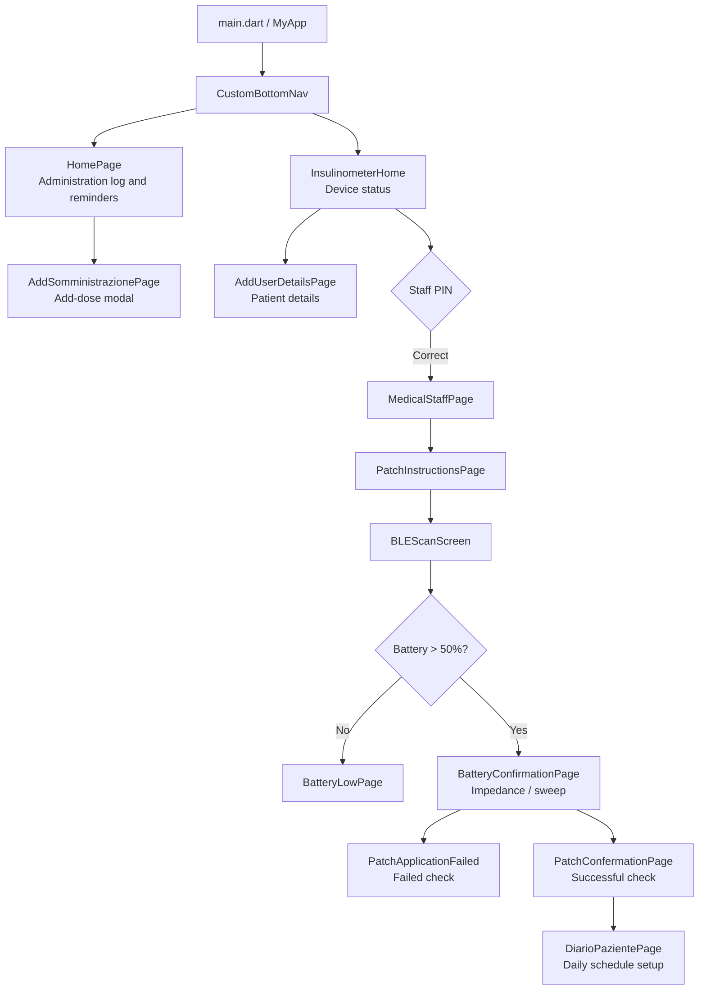

# Frontend, UI/UX, and Navigation

[← README](../README.md) · [Architecture](ARCHITECTURE.md) · [Known issues](KNOWN_ISSUES.md)

## Interface approach

InsulinGuard provides separate workflows for **patients** and **healthcare staff**, with compact navigation and clear task feedback. The UI combines **Material** widgets (`Scaffold`, `Card`, dialogs, snackbars) with **Cupertino** widgets (`CupertinoTabScaffold`, `CupertinoTabBar`, alerts). Navigation uses `Navigator.push` and `showDialog`; state updates use `Provider` and `ChangeNotifier`.

## Screens and navigation

The device tab also includes a placeholder view. Measurement results can trigger navigation from controller callbacks and timers.

### Patient journey

| Screen | Observed behavior |
| --- | --- |
| `HomePage` | Reads administrations from `DatabaseHelper`, highlights the next dose, allows confirmation/deletion, and schedules a notification **one minute before** the nearest future administration |
| `AddSomministrazionePage` | Modal for date, time, dosage, and insulin type |
| `DiarioPazientePage` | Configures morning/afternoon/evening events, saves three local entries, and schedules reminders |
| `InsulinometerHome` | Displays device status and provides access to healthcare-staff features |

The diary stores date and time as text. Standardizing the formats used by `DateFormat('yyyy-MM-dd HH:mm')` and `TimeOfDay.format(context)` would avoid locale-dependent parsing errors.

### Healthcare staff journey

`secondary_page.dart` displays connection state, battery level, and patient details. Entry to `MedicalStaffPage` is protected by a PIN stored in `shared_preferences`, defaulting to `0000`. This is **a demonstration UI gate, not secure authentication**.

| Step | Screen / operation |
| --- | --- |
| Instructions and scan | `PatchInstructionsPage` → `BLEScanScreen`: scan and establish GATT connection |
| Battery | `BLEController.updateBattery()`: proceed only when level **> 50**; otherwise open `BatteryLowPage` |
| Patch contact check | `BatteryConfirmationPage`: send `0x02`, evaluate impedance, issue `0xFF` STOP |
| Sweep | Send `0x03` requesting three spectra, then perform monotonicity and standard-deviation checks |
| Result and log | `PatchConfermationPage` / `PatchApplicationFailed`, followed by `DiarioPazientePage` where applicable |

The thresholds are research-prototype parameters. See [BLE protocol](BLE_PROTOCOL.md) for the implementation details.

## Reactive state and asynchronous UX

**GATT notification → `BLEConnectionController` → `BLEController.handleIncomingData(...)` → parsing/CRC → `notifyListeners()` → rebuild of Provider-observing widgets.** Some outcomes and timeouts also call `Navigator.push` directly from the controller, coupling protocol and presentation.

| Event | State / UI response |
| --- | --- |
| Scan, connection, link loss | `BLEConnectionController`: device list, connection status, and banner |
| Battery, patch checks, sweep | `BLEController`: battery value and result flags; progression through the workflow |
| Profile/PIN or log edit | `AppState` and `DatabaseHelper`: widget updates and reloading persisted records |

`BatteryConfirmationPage` coordinates waiting periods and checks, while some statistics live in the controller. Domain and presentation responsibilities are therefore not completely isolated.

## Visual design and accessibility

| Element | Implementation |
| --- | --- |
| Branding and navigation | Blue primary actions, `Home`/`Dispositivo` (“Device”) tabs, a Material/Cupertino mix |
| Feedback | Green for successful checks, red/orange for errors; dialogs, snackbars, indicators, and dedicated screens |
| Components | Cards and rounded corners; **no verified centralized design-token system** such as `ThemeExtension` |

The interface uses both Italian and English strings. Centralized localization, accessibility testing, contrast checks, and large-text support are areas for improvement.

Further improvements include decoupling navigation from packet parsing, standardizing date formats, centralizing UI styling, adding widget/accessibility tests, and strengthening staff authentication. See [Known issues](KNOWN_ISSUES.md).

## Screenshots

The [README screenshot gallery](../README.md#screenshots) shows the main patient, device, BLE, and patch-setup screens. Some UI labels in the images are in Italian.
