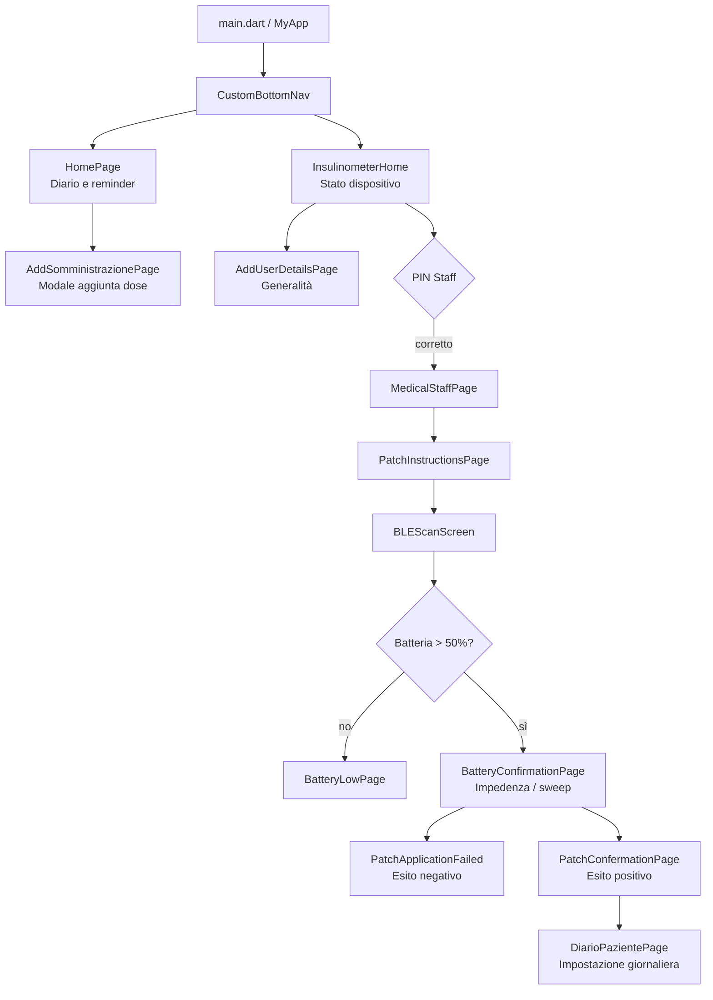

# Frontend, UI/UX e navigazione

[← README](../README.md) · [Architettura](ARCHITECTURE.md) · [Verifiche](KNOWN_ISSUES.md)

## Impostazione dell'interfaccia

La tesi di **Michele Contino** (cap. 2–3) descrive un'esperienza distinta per **paziente** e **personale sanitario**, con percorso breve, leggibilità e controlli riconoscibili. Il codice combina widget **Material** (`Scaffold`, `Card`, dialog, snackbar) e **Cupertino** (`CupertinoTabScaffold`, `CupertinoTabBar`, alert), `Provider`/`ChangeNotifier` e `Navigator.push`/`showDialog`: non è presente un router dichiarativo centralizzato.

## Schermate e navigazione

Il diagramma riassume collegamenti del prototipo: alcune transizioni di esito sono avviate da callback/timer nel controller e richiedono verifica runtime. La tab Dispositivo interna a `InsulinometerHome` include anche un placeholder (`Contenuto Dispositivo`), da non presentare come funzionalità completa.

### Percorso paziente

| Schermata | Comportamento |
| --- | --- |
| `HomePage` | Legge le somministrazioni da `DatabaseHelper`, evidenzia la prossima dose, consente conferma/cancellazione e pianifica una notifica **1 minuto prima** dell'evento futuro più vicino. |
| `AddSomministrazionePage` | Modale per data, ora, dosaggio e tipo di insulina. |
| `DiarioPazientePage` | Configura mattina/pomeriggio/sera, salva tre eventi locali e pianifica promemoria. |
| `InsulinometerHome` | Espone stato dispositivo e accesso agli strumenti staff. |

Il database locale usa date testuali: `DateFormat('yyyy-MM-dd HH:mm')` e `TimeOfDay.format(context)` **non sono necessariamente compatibili** in tutte le impostazioni locali. La sincronizzazione completa del calendario con il firmware, prevista nelle tesi, non è stata verificata.

### Percorso personale sanitario

`secondary_page.dart` legge connessione, batteria e dati paziente. L'accesso a `MedicalStaffPage` avviene tramite PIN salvato in `shared_preferences` con default `0000`: **è un blocco UI dimostrativo, non autenticazione sicura**.

| Passaggio | Schermata / operazione |
| --- | --- |
| Istruzioni e scan | `PatchInstructionsPage` → `BLEScanScreen`: ricerca e connessione GATT. |
| Batteria | `BLEController.updateBattery()`: valore **> 50** per proseguire; altrimenti `BatteryLowPage`. |
| Controllo patch | `BatteryConfirmationPage`: comando `0x02`, verifica impedenza, `0xFF` STOP. |
| Sweep | Comando `0x03`, tre sweep, monotonicità e deviazione standard. |
| Esito e diario | `PatchConfermationPage` / `PatchApplicationFailed`, poi `DiarioPazientePage` quando previsto. |

Soglie e algoritmi sono **prototipali**; dettagli e discrepanze con le tesi in [Protocollo BLE](BLE_PROTOCOL.md).

## Stato reattivo e UX asincrona

**Notifica GATT → `BLEConnectionController` → `BLEController.handleIncomingData(...)` → parsing/CRC → `notifyListeners()` → rebuild dei widget Provider.** Alcuni esiti e timeout provocano inoltre `Navigator.push` direttamente dal controller, accoppiando protocollo e presentazione.

| Evento | Stato / reazione UI |
| --- | --- |
| Scan, connessione o perdita link | `BLEConnectionController`: elenco dispositivi, banner e stato connessione. |
| Batteria, validazione patch o sweep | `BLEController`: valore e flag di esito, proseguimento del workflow. |
| Profilo/PIN o diario modificati | `AppState` e `DatabaseHelper`: aggiornamento dei widget e ricaricamento record. |

`BatteryConfirmationPage` orchestra attese e controlli; parte delle statistiche è nel controller. La separazione tra dominio e UI è quindi incompleta.

## Convenzioni visive e limiti

| Elemento | Osservato nel codice |
| --- | --- |
| Identità e navigazione | Blu per azioni principali, tab `Home`/`Dispositivo`; mix Material/Cupertino. |
| Feedback | Verde per conferma, rosso/arancione per errore; dialog, snackbars, indicatori e schermate dedicate. |
| Componenti | Card e bordi arrotondati, ma **nessun sistema centralizzato di token** (es. `ThemeExtension`) verificato. |

La tesi punta ad accessibilità e adattabilità; **non sono però documentati test WCAG, contrasto misurato, supporto completo screen reader, text scale elevata, localizzazione strutturata o test sistematici dei formati regionali**. Le stringhe sono spesso hardcoded in italiano/inglese.

Priorità evolutive (non implementate): estrarre workflow della patch e navigazione dal parser, unificare date e stato del diario, centralizzare il tema, introdurre test widget/golden e accessibilità, rendere sicura l'autorizzazione staff. L'audit dettagliato è in [KNOWN_ISSUES.md](KNOWN_ISSUES.md).

## Screenshot

La [galleria del README](../README.md#schermate-dellapplicazione) mostra Home, Dispositivo, Staff, scan BLE, batteria e conferma patch. Le immagini locali `assets/screenshots/` provengono da figure delle tesi (attribuzioni nel README): sono schermate del prototipo, **non evidenza di test sull'app corrente**.
